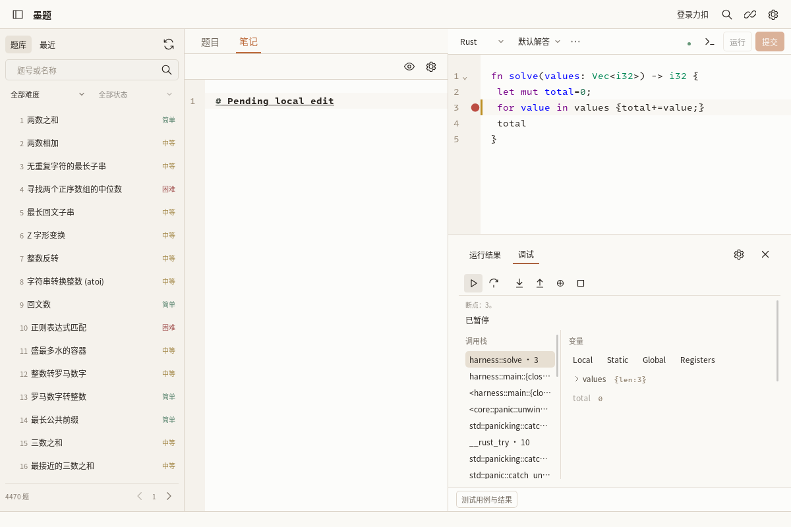

# 六语言模板与源码边界适配方案

状态：首轮适配修复与分层验证完成；剩余边界继续开发。当前支持 Python、Rust、Go、C、C++、Java。
核查基线：f25d6ccb4f0312d555a4aab3c3625b157cbdbc5a。
本报告不声称六语言已与中国站在线执行环境完全一致。

## 不变量
1. 官方模板来自中国站题目 GraphQL 的 codeSnippets，以 langSlug 精确选择。记录来源、题目 ID、语言与抓取版本。新解答使用原文；刷新绝不覆盖已有解答。
2. 用户源码是唯一持久化、导出与提交正文。导入、注释、Unicode、行尾、末尾换行都保留。提交 typed_code 必须逐字等于确认时冻结的源码快照。
3. LSP 支持代码和本地测试入口属于临时派生文件。不得写回解答，不得混入正式提交。标注有效映射范围，拒绝来自辅助区的 Rename/编辑。
4. 每种语言各有适配器，配置、签名约束和支持类型共享；不以字符串拼接同一规则处理全部语言。
5. 编译器版本、edition/标准、默认导入与可用第三方库必须有独立中国站证据。国际站资料只能作参考，不能冒充中国站已验证配置。

## 各语言要求
- Rust：保留 use、别名、组合导入、完全限定路径；不默认注入 HashMap。统一 LSP/运行器的 Solution、ListNode、TreeNode 冲突处理，节点内部使用完全限定 std 路径。检查借用/可变引用、泛型、关键字函数名、crate 属性与 include 上下文。LSP 和编译器 edition 必须一致。
- Python：显式 import/from import 原样执行；future import 与模块文档字符串位置合法。运行器提供的默认名称必须与编辑器一致且可追溯，节点构造/序列化与异常栈映射必须一致。不得在运行前改写用户 import。
- Java：保留 import/package 的相对顺序，解析官方类/方法签名；处理静态与实例调用、ListNode/TreeNode、泛型集合与编译诊断行映射。自定义 package 的本地支持必须明确，不能在 package 前插普通 import。
- C++：保留 include、namespace、别名与模板；头文件和语言标准与已验证环境匹配。节点定义去重需同时顾及用户翻译单元和驱动翻译单元。
- C：保留 include、typedef 与真实 C 编译路径；签名中的指针、返回长度、二维列长度和所有权要显式适配。驱动用 C++ 并不意味着用户 C 源码可按 C++ 编译。辅助结构定义不能靠粗暴删除解决重复。
- Go：保留 package/import，函数名与官方签名一致；固定 go.mod 与可用依赖。包级节点声明跨文件可共享，但 import 按文件生效，不能把驱动 import 当成用户源码的 import。

## 2026-10-14 检查点
应用源码：ec3bd376ef979f942db613b0b428c5dbb6e6573c。之后至 d2c2db36 仅修改测试键盘注入方式、打包说明与打包工作流，未改变应用源码。
- 官方模板使用精确 langSlug 唯一匹配；缺失/歧义返回不可用，禁止以新建解答覆盖现有源码。六语言 Unicode/CRLF/末尾换行原样单测已通过。
- typed_code 等于冻结 snapshot.code；本地 solution ID 不发送给中国站；旧 journal 无 solution 字段仍可读取。
- Rust LSP/运行器共享辅助类型检测；HashMap 显式/组合别名/全限定、自定义 Solution/ListNode 实编译通过。
- Java LSP/运行共享 util/math/io；集合返回以 Object 接住并按值序列化；显式 HashMap 与自定义节点通过。自定义 package 本地运行明确拒绝。
- Python 虚拟公共导入补全与运行已覆盖 deque/Counter 等；作者节点类显式传递给转换器，支持嵌套节点数组与 void 修改，循环/共享树/非法绑定仍拒绝。运行器 dir() 的偶然导出不视为公共 API。
- C++ 标准头文件单一来源供 LSP/运行复用；using namespace std 仅属于 C++ 上下文，不泄漏到 C 驱动；自定义节点不会被重复定义。
- C 仍由 C11 编译器单独编译，显式 includes、malloc 返回、二维尺寸、64 位整数与循环拒绝通过。
- Go 显式别名、slices、自定义节点与 package 源行映射通过；驱动的 import 不冒充用户 import。

### 实际证据
| 层级 | 来源提交 / run | 结果与范围 |
| --- | --- | --- |
| Rust 私有工具链 | cc210f7 / [38509626336](https://github.com/jacek4yang/inkleet/actions/runs/38509626336) | Linux、Windows、Intel/ARM macOS 各 14 用例通过 |
| Java 私有工具链 | cc210f7 / [38509626323](https://github.com/jacek4yang/inkleet/actions/runs/38509626323) | 四平台各 14 用例通过 |
| Go 私有工具链 | 62aa363 / [38511268386](https://github.com/jacek4yang/inkleet/actions/runs/38511268386) | 四平台各 12 用例通过 |
| C 私有工具链 | 8617eaf / [38511589962](https://github.com/jacek4yang/inkleet/actions/runs/38511589962) | 四平台各 12 用例通过 |
| C++ 私有工具链 | 8617eaf / [38511589926](https://github.com/jacek4yang/inkleet/actions/runs/38511589926) | 四平台各 12 用例通过 |
| Python / Pyright / debugpy | d15e1d1 / [38511124153](https://github.com/jacek4yang/inkleet/actions/runs/38511124153) | 四平台真实隐式补全、节点/导入、源码保持与 DAP 通过 |
| Linux 原生完整语言流程 | ec3bd376 / [38511688571](https://github.com/jacek4yang/inkleet/actions/runs/38511688571) | 六语言实际下载、补全、F12 标准库、本地运行、断点/单步/停止；Python 另有内层函数、Watch、栈帧切换与过期结果丢弃 |
| Linux 安装/解压 | ec3bd376 / [38511819107](https://github.com/jacek4yang/inkleet/actions/runs/38511819107) | 实际 DEB 安装、tar 启动、命名解答保存、冲突、恢复通过 |
| 说明修订重新打包 | d2c2db36 / [38512596069](https://github.com/jacek4yang/inkleet/actions/runs/38512596069) | 复用并 cmp 校验同一已测试二进制；没有重编译或正式 Release |

Linux 原生截图（本地测试样例，非在线判题）：

### 保留的失败与未验证
- C 标准头复用初版误引入 using namespace std，identity 与 std::identity 冲突；8617eaf 移出 using 并限定 C 调用为全局符号后，原四平台用例通过。
- WebKit 的复合 XPath 不能稳定定位变量值：改为同语义 CSS 和 textContent，数值断言保留。
- PR7 a97354f 的 WebDriver 文本输入发生 RemoteDisconnected；driver 显示连接重置，随后截图成功，无内核崩溃/OOM 证据。没有重放不确定输入。后续测试使用一次 OS ASCII 输入，Enter/Tab/Backspace 与逐字保存断言不变，其独立完整回归仍在运行。
- 原生 run 的匿名登录控件自动化标为 UNVERIFIED；截图可见官方登录窗口，但窗口路由断言未完成。真实账号登录、在线运行/提交仍未验收。
- Windows/macOS/Android 原生 GUI 不由上述编译器或协议探针替代。Typora 真实进程启动未验证。
- 中国站具体编译器版本与依赖清单尚未独立核实；Rust 当前本地/LSP edition 2021，不能仅根据国际站文档升级。
- C 作者自定义节点 ABI、Java 泛型集合输入、Rust include 上下文中的 crate 级属性、Python future 分号复合语句仍需专门适配。
- 设计类/特殊接口、任意第三方依赖、长时间稳定性及性能基线不在本检查点通过范围。

### 可复现步骤
1. 新题切换六种语言，比较编辑器默认文本与该题中国站模板；已有解答切换/刷新不可被覆盖。
2. 分别写显式标准库导入（Rust HashMap、Java HashMap、Go strings 别名、C 标准头、C++ unordered_map、Python Counter），运行普通函数，保存文件应保持原文。
3. 同题复制/命名解答，切换语言再返回，重启，检查源码、断点和草稿归属；制造外部笔记修改并保留双方恢复副本。
4. Python 在内层函数断点暂停、展开数组、增加 Watch、切换调用栈、step-out；旧帧结果必须失效。其他语言分别验证原源码断点、F10 数值变化、Shift+F5。
5. 运行对应 Actions 工作流取得完整日志；不同层级的 PASS 不能代替在线评测。

## 验收
每种语言单独记录：官方模板相等；标准库显式导入；未导入名称的诊断；普通题、多参数、数组/二维数组、链表、树、原地修改；非法签名；代码与辅助定义冲突；编辑/运行/调试坐标一致；提交序列化正文相等。
Rust 另测 HashMap 普通/别名/组合/完全限定导入，Rc/RefCell，leading inner attributes。
命名解答之间不共享源码、运行归属、断点或编辑状态；原默认文件无覆盖迁移。
浏览器模拟、真实编译、Linux 原生 GUI、中国站在线评测分别记结果。未真实提交的项目保持未验证。
不为了通过测试删除现有有效断言，不执行自动提交。

## 参考
- Rust Book HashMap：https://doc.rust-lang.org/book/ch08-03-hash-maps.html
- Rust prelude：https://doc.rust-lang.org/std/prelude/
- LeetCode 国际站环境资料（不是中国站确认）：https://support.leetcode.com/hc/en-us/articles/360011833974-What-are-the-environments-for-the-programming-languages
- 中国站帮助中心：https://leetcode.cn/help-center/
