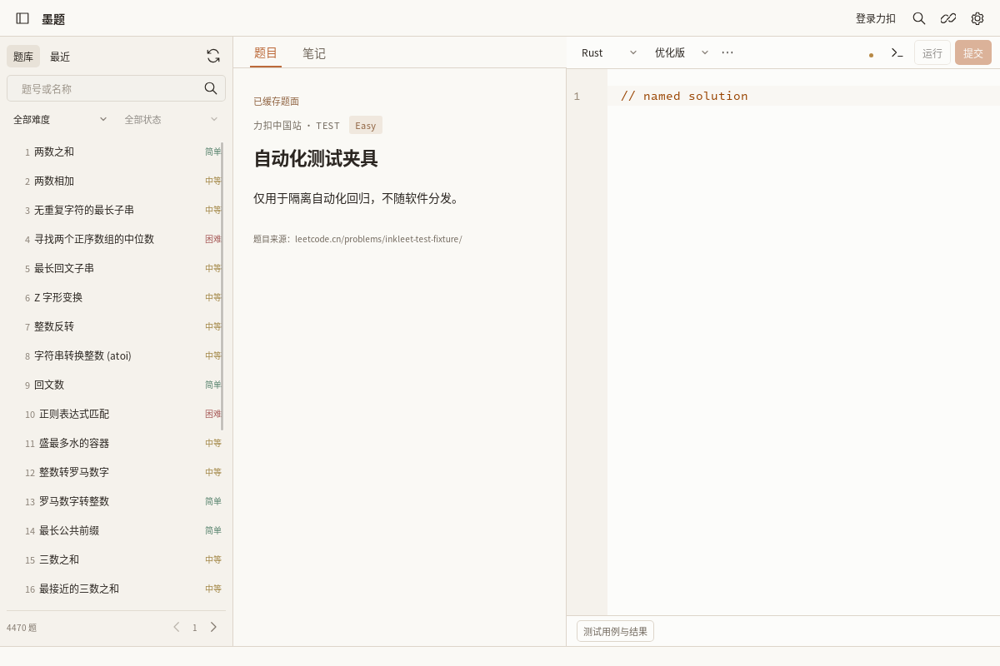

# 命名解答检查点

## 范围与界面
每道题、每种语言可保存多份独立命名解答。语言右侧是紧凑的解答选择器，⋯ 中提供新建、复制、重命名、刷新；不常驻显示教学说明。
名称是显示文字，不参与文件路径。不可变 ID 保持源码、保存队列、撤销/光标状态、断点与恢复归属。
当前不提供删除操作；已实现的功能不以空菜单占位。
笔记按题目共享；解答选择记忆限当前进程，重启后可以从持久列表重新选择。

## 旧数据与存储
- 原 notebook/<problem>/solution.<ext> 原样保留，为 default 解答；无覆盖式迁移。
- 新源码位于 .solutions/<language>/<id>/solution.<ext>，名称位于同目录 name.json。
- 默认解答改名仅写 default.json，不搬动原源码。
- 创建先在同级暂存目录写入并同步源码与名称，再发布整个目录。未完成/异常记录有界扫描并报告，不删除或伪装成默认源码。
- 缺失、损坏、符号链接或非普通命名源码明确失败，不能借旧保存请求重建目标。
- 冲突与恢复副本位于各自源码目录；notes.md 及笔记恢复仍共用题目目录。
- 写入沿用原文件冲突检查和原子替换；进程内由 Store.gate 串行。不能宣称对恶意并发文件系统写入提供无竞态 CAS。

## 状态与异步边界
DraftKey 默认键保持原三元组；命名解答附加第四个 ID，不改变题目所在索引。
读取、保存、冲突、恢复、在线评测快照、运行/调试归属均携带解答身份。
已知评测结果按解答归属显示；待确认提交保护仍覆盖同账号同题所有语言/解答，不能用复制解答绕过。
命名对话框捕获复制时的源码；迟到结果不会在用户切换题目/语言后强行选中新解答。
创建/改名失败保留当前草稿与输入；重命名不重建 EditorView。

## 参考与许可证
Lithe 固定参考 6210013d06e1410c7bcbb1949e1ff16ea8deae15。
设计对照 windows/tauri/src/features/editor/stores/editor-session-state.ts 的文档身份与状态分离。
分类 B：结合 InkLeet CodeMirror 会话缓存重新实现；没有直接移植 Monaco/Swift 组件，没有复制 Lithe 代码或素材。
原有 Tauri 2 + React + CodeMirror 6 + Rust 架构不变。

## 已有测试证据
源码 f25d6ccb4f0312d555a4aab3c3625b157cbdbc5a：
- 浏览器 CI 38508512737：完整前端套件通过，包括复制快照、重命名 ID、切换语言、同名拒绝、写入失败保留草稿。
- Linux 原生 38508509133：NAMED_SOLUTIONS_NATIVE_RESULT.txt 通过真实 UI 复制、重命名、独立文件保存、重启恢复与旧文件不变。
- 该原生整套任务仍失败于后续调试监视控件不可交互，不能把命名功能证据冒充全套通过。
- 61924ed 新增同解答恢复、跨解答恢复拒绝及六语言共享笔记单元测试，待原生构建检查完成。
- Windows/macOS/Android 命名解答原生 GUI 尚未验收。

## 复现
1. 打开题目，用默认 Rust 解答写入 A。
2. ⋯ → 复制解答，命名“双指针”，改为 B。
3. ⋯ → 重命名为“优化版”；切回默认解答，内容仍为 A。
4. 切到 Python，其解答列表独立；切回 Rust，当前进程中回到原选择。
5. 重启后选“优化版”，内容仍为 B，默认解答仍为 A。
6. 在解答源码外部修改后继续编辑，应出现冲突而不覆盖外部文件；恢复副本不能出现在另一解答。
7. 新建/复制同名解答或模拟写入失败，当前正文不能丢失；名称输入保留并显示错误。
