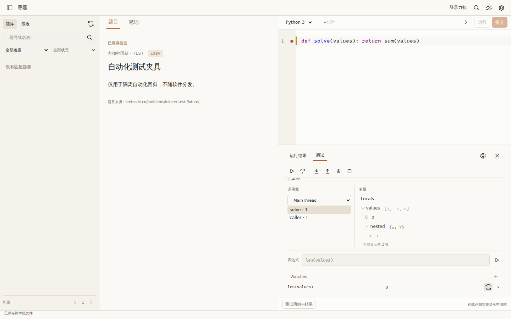

# Debugger workspace checkpoint

Status: browser regression and 20 domain tests PASS on 2288bdfbb921a272738dd0ce5cd5dff0fadcc03a (CI 38503082581). Native acceptance is still pending. Not JetBrains parity.
Base application: f0ec2a6dbb470912af87734f719c96d405f51715; native input helper fix:6257a74ac7fce3b7473a77d4ff68cfecf2dbe3ea.

## References and adaptation

Lithe reference is pinned to **6210013d06e1410c7bcbb1949e1ff16ea8deae15**.
Design-only (B): windows/tauri/src/features/debugger/components/debugger-view.tsx;
windows/tauri/src/ui/icons.tsx. No source or icon asset copied.
Monaco and macOS Swift are category C, not portable Web components.

Official JetBrains references:
- https://www.jetbrains.com/help/rust/debug-tool-window.html
- https://www.jetbrains.com/help/rust/stepping-through-the-program.html
- https://www.jetbrains.com/help/rust/examining-suspended-program.html
- https://www.jetbrains.com/help/rust/using-breakpoints.html
- https://microsoft.github.io/debug-adapter-protocol/specification

Stack selection determines inspection context; nested variables preserve parents.
Read results require session, pause epoch and frame identity. Collapsed/unmounted
nodes ignore late results. Frame ID zero is valid. Variable expansion is explicit
and bounded at 100 children and 12 levels; pagination remains unimplemented and
the limit is shown. References are never persisted across resumes.

Watches currently live in the panel for the current UI lifetime and are explicitly
refreshed, one expression at a time. They do not automatically call user functions
on every step. Results disappear when frame/pause changes. No claim of project
persistence or JetBrains automatic watch behavior. Java evaluation remains unsupported.

Thread enumeration and thread-specific stacks are available for inspection.
Stepping still operates on the adapter's stopped thread, NOT the selected
inspection thread; labels must make this explicit. No single-thread freeze claim.

## Capability plan and honest gaps

Initialize capability booleans are captured and default false; this is plumbing,
not completed UI features. Conditional/hit-count/log breakpoints, smart step targets,
run-to-cursor, restart frame, exception controls, value mutation and source snapshot
navigation are NOT implemented in this checkpoint. Smart step is not documented on
the cited RustRover stepping page and cannot be presumed supported for Rust.

Run-to-cursor must execute intermediate code through an owned temporary breakpoint;
DAP goto skips code and is not an equivalent. Temporary breakpoints must coexist
with user breakpoints and be verified before continuing. Never silently downgrade a
conditional breakpoint to unconditional.

Existing execution/online submission guards, source snapshot isolation and save
conflict protections are unchanged.

## Reproducible acceptance

Browser fixture: expand values -> nested -> x; parents stay visible.
Add len(values) watch and refresh explicitly. Select caller frame (ID zero),
require caller_only and hide previous watch result. Delay nested variable response,
switch frame and resolve it; old children must not appear.
Retain existing double-start, evaluation serialization, late evaluation, shortcuts,
SVG accessibility, changed-source, stop and all unrelated assertions.

Native: verify Python/Go/C/C++/Rust/Java existing step-over before claiming pass.
Additional real Python nested-function step-in/out, caller frame, variable tree and Watches assertions have been added; execution results still pending.
Windows/macOS/Android native debugger UI unverified.
Screenshots are generated by CI; browser fixture screenshots are not native evidence.

## Evidence and failures

Application SHA: 2288bdfbb921a272738dd0ce5cd5dff0fadcc03a.
Browser artifact 11866568664, SHA256 ee8b4d8d02c97fa34e1cfe1f7df80de1376314607380399ff990b65af4094b7c.

This is the actual application rendered with isolated test data; it is not native evidence.

Earlier native run 38502385720 at 50f702d passed compilation/unit tests and
Python evaluation, then failed Java variable lookup: the new span around variable
names broke the existing direct-text XPath. Restored direct label text in e16df33;
no assertion was removed. New native run pending. Its public LeetCode probe had
outcome failure despite the continue-on-error step conclusion; live CN UI was skipped.

Execution-changing requests and expression evaluation now share a try-lock gate;
stop remains independent. Adapter inspection values are validated and bounded;
malformed entries cannot crash the tree. Toolbar exposes one primary start/resume
control, rather than a disabled duplicate start control during a live session.
