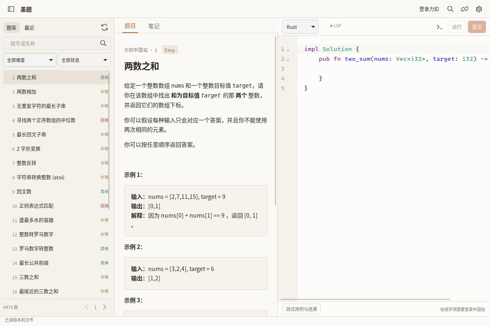

# Input surfaces and download-only proxy checkpoint

## Scope
Requested by the owner: quieter, more professional inputs; improve code input; configure a proxy used only for downloads. This checkpoint implements input styling and download configuration. Snippet/LSP and JetBrains-style debugger work remain separate checkpoints.

## Implementation
- Search, Settings, rename, test-input and expression fields share subdued surfaces, consistent radii/padding and visible focus borders. Expression action aligns on the same row.
- Settings → 下载 offers system, direct and custom HTTP/HTTPS routing.
- Custom endpoints accept only scheme/host/port. Credentials, URL paths/query/fragment, invalid ports and unsupported schemes are rejected. SOCKS endpoints are not claimed supported; use the proxy software's HTTP/mixed listener.
- The configuration is passed to the managed-package HTTP client only. Explicit custom mode disables inherited proxy fallbacks; direct mode disables proxy use for this downloader.
- gopls dependency downloads receive proxy variables only in the private installer command's isolated environment. No process-global environment or OS/network setting is changed. LSP and user-code runtime commands do not receive this custom setting.
- Existing package origin allowlist, HTTPS, redirects, sizes, content-range, hashes and archive protections remain.
- Each install/group takes a validated settings snapshot before queuing, so already-running downloads keep their original route.
- Version-1 config uses explicit Save, atomic persistence, expected-revision conflict protection and a prior-valid-config backup. Corrupt/unknown versions are not overwritten. UI failure is visible and retains entered values and the prior loaded baseline. A post-replacement fsync failure is reported as uncertain disk state and requires re-read, rather than falsely claiming unchanged disk.

## References and boundaries
Lithe settings/error-reporting comparison remains pinned at 6210013d06e1410c7bcbb1949e1ff16ea8deae15; this does not copy its debounce-and-console-only persistence failure pattern.
No proxy setting is added to the LeetCode client, login WebView, online judge, editor LSP session or local program launcher.
No credentials or system trust exceptions are introduced.

## Reproducible acceptance
1. Settings → 下载 → custom: enter an HTTP loopback endpoint and Save. Close/reopen/restart: validated value remains.
2. Enter a credential-bearing URL or unsupported scheme: native validation rejects it without replacing the saved document.
3. Change config externally while Settings is open: stale Save is refused. Failed backup/write retains entered UI text and recovery information.
4. Rust loopback proxy fixture observes an HTTPS CONNECT for nodejs.org through the explicit proxy; no external request succeeds or runs software.
5. Native regression saves/restarts/restores system mode before actual managed installations.
6. Download/install six private environments; LeetCode public access and editor/debug commands continue using their original clients.
7. Inspect expression/search/Settings fields at desktop/mobile widths for aligned controls and unclipped focus.

## Evidence
Pending this commit: Rust proxy routing/config persistence tests, browser failure/reopen/double-save tests, native Settings persistence and full six-language GUI.
Existing native UI checkpoint 3fb6b8e passed six-language installation/completion/source/local run/debug, actual Python evaluation, editing keys, rename/references, conflicts/recovery and public CN/offline flow in run 38499195464. Anonymous login UI remained UNVERIFIED.
No real authenticated proxy/account interaction or Windows/macOS/Android native acceptance is claimed. No merge or Release.

## Verified checkpoints (2026-10-14)

- Browser CI 38502208793 at 6257a74 passed all regressions.
- Native 38502203562 at 6257a74 passed six-language local IDE checks and download
  configuration save/restart. Artifact11866905178 SHA256
  cddf362d5a11ac51edec9124bbd327b8ac9ee2f3435efb7ec7d2333119954cd9.
- That run's public CN probe failed strict difficulty validation, so green local
  native status is NOT proof of online compatibility.
- c3f8bbb normalized the two known difficulty wire casings. Real public CN probe
  then passed in run38503742736 (exit-code0), and the actual Linux GUI sidebar
  opened Two Sum and its official Rust template. Artifact11867055866 SHA256
  d37a3d5ee056bd3b54a83f8fac1905058fea6cd0d6d3a68b6b3b7e3506123c12.
  This run later failed WebDriver transport while pasting Java fixture input;
  the full suite was not declared passed. 80b5619 uses verified-focus X11 keyboard
  paste and preserves exact text/disk assertions. New result pending.
- Authenticated completion filtering, real login and online judge are unverified.

